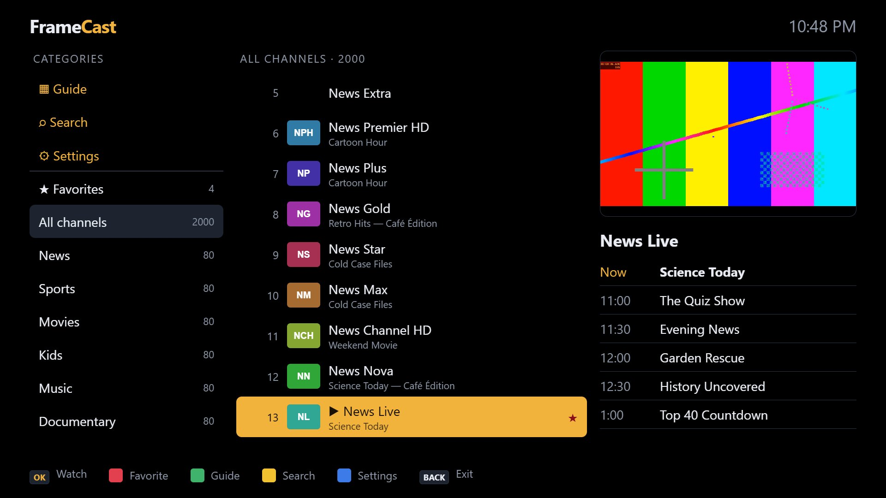
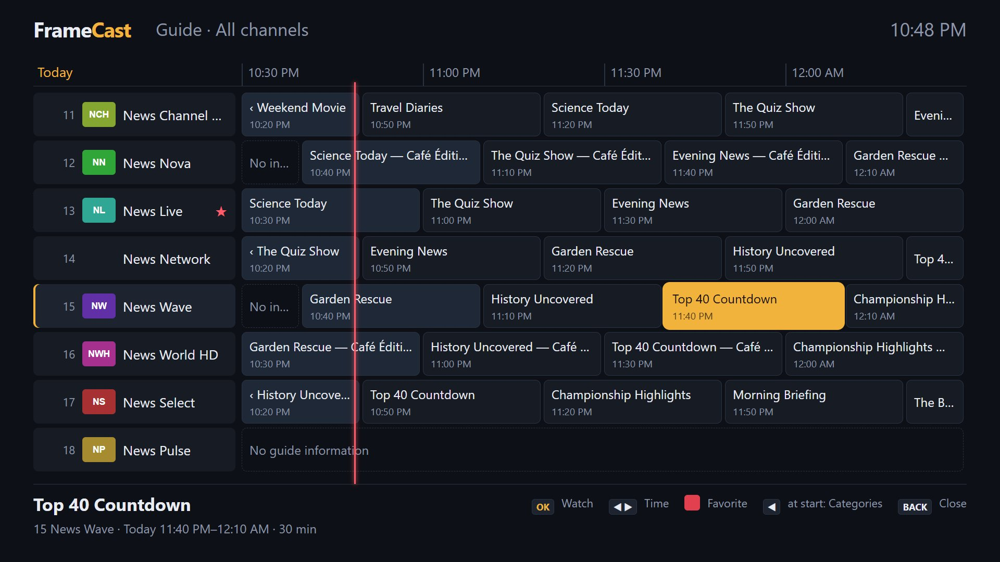
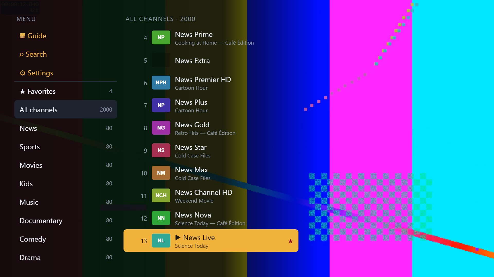
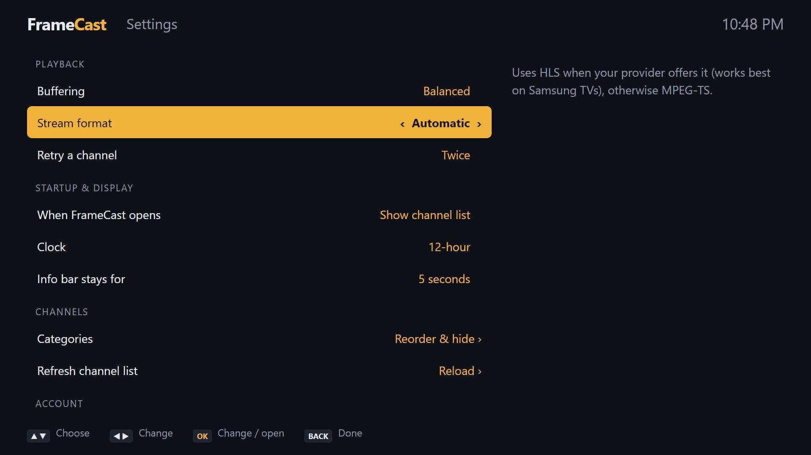
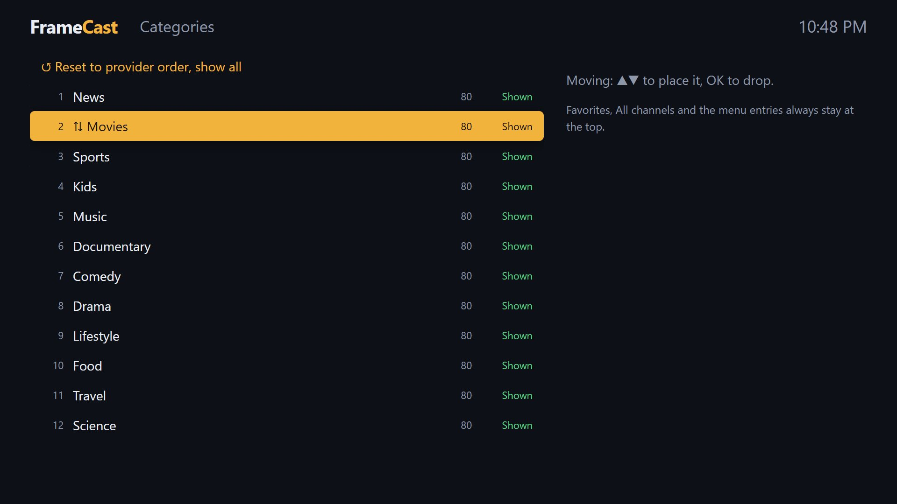
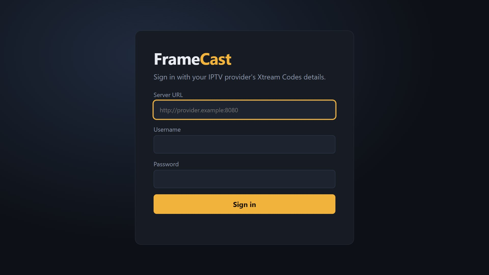

# FrameCast

A live-TV player for Samsung Tizen TVs, including **The Frame**. It signs in to an
**Xtream Codes** IPTV provider directly from the TV, so no PC or server is needed while you watch. I made this for myself using claude to run on my frame TV. I recommend if you want to use it then you should get claude to help you to set it up. Should take about half an hour. Annoying part is getting Samsung app registration to upload to TV. Once that is done it is easy. There's certain remote permissions you can give claude so it does the testing for you.



- **Live channels by category.** Handles providers with tens of thousands of channels (only the rows on screen are drawn).
- **Programme guide.** A classic grid (channels × time) you can scroll through the day, plus now/next in every channel row.
- **Menu over the video.** Press ◀ while watching to browse categories and channels without leaving full screen.
- **Favorites and search.** The red button stars a channel; the yellow button searches by name.
- **Your layout and settings.** Reorder or hide categories; choose buffering, stream format, retries, clock format and more.
- **TV-native playback.** Uses Samsung's hardware player (AVPlay), with a live preview window in the channel list.
- **Remote-first.** CH ▲▼ to change channel, the number pad to jump to a channel number, colour buttons as shortcuts.

Tested on a 2025 The Frame (QN55LS03F, Tizen 10). Written for Tizen 3.0 and newer (2017+ Samsung TVs).

> FrameCast is a player only. It doesn't come with channels or subscriptions; you need your own
> Xtream Codes account (server URL, username and password) from an IPTV provider.

### Screenshots

| | |
|---|---|
|  **Programme guide**: channels × time, scroll through the day |  **Menu over the video**: press ◀ while watching |
|  **Watching**: now/next and progress in the info bar |  **Settings**: buffering, stream format, retries and more |
|  **Category editor**: reorder and hide categories |  **Sign in**: your provider's Xtream Codes details |

<sub>Screenshots use the built-in demo provider (`dev/server.js`): the channels, programmes and test-pattern
video are made up.</sub>

---

## Using FrameCast

On first launch, enter your provider's **server URL**, **username** and **password**. Use the arrows and OK
to move between fields; OK on a field opens the TV keyboard. FrameCast remembers the account and signs in
automatically from then on.

The colour buttons work everywhere: 🔴 **Red** favorite · 🟢 **Green** guide · 🟡 **Yellow** search ·
🔵 **Blue** settings. **Guide**, **Search** and **Settings** are also at the top of the side menu.

| Where | Button | Does |
|---|---|---|
| Channel list | ▲ ▼ | Move · CH ▲▼ jumps a page |
| | ◀ ▶ | Switch between the side menu and channels · ◀ in the side menu jumps back to the top |
| | OK | Watch full screen (or open Guide / Search / Settings from the menu) |
| | 0–9 | Jump to a channel number |
| | BACK | Stop the preview → side menu → exit (press twice) |
| Watching | CH ▲▼ or ▲▼ | Next / previous channel in the list you came from |
| | ◀ | **Open the menu over the video:** browse and switch channels while watching (◀ again moves to the side menu, and once more jumps to its top); ▶ or BACK closes it |
| | OK / INFO | Show the info bar |
| | 0–9 | Jump to a channel number |
| | BACK | Back to the channel list (the channel keeps playing in the preview) |
| Guide | ◀ ▶ | Move through time (◀ at the earliest time picks a category) |
| | ▲ ▼ · CH ▲▼ | Move between channels · jump a page |
| | OK | Watch that channel |
| | BACK | Close the guide |
| Settings | ▲ ▼ · ◀ ▶ | Choose a setting · change it |
| Categories editor | OK · ◀ ▶ | Pick up and move a category · show or hide it |

### Settings

| Setting | Options |
|---|---|
| Buffering | Fast start (2 s) · Balanced (4 s) · Fewer stalls (8 s). Applies straight away to the channel you're watching |
| Stream format | Automatic · HLS · MPEG-TS |
| Retry a channel | Off · once · twice · 3 times |
| When FrameCast opens | Show channel list · Play last channel |
| Clock | 12-hour · 24-hour |
| Info bar stays for | 3 / 5 / 8 seconds · Until dismissed |
| Categories | Reorder & hide (Favorites, All channels and the menu entries stay on top) |
| Refresh channel list · Sign out | |

If the picture keeps pausing to buffer (twice within a few minutes), FrameCast offers to switch to a bigger
buffer: **OK** switches and restarts the channel, **BACK** says not now and it won't ask again for 30 minutes.
On the biggest buffer it tells you the channel or connection is the likely problem instead.

If a channel doesn't connect, FrameCast retries it automatically (up to three attempts) before showing an
error. If it still can't play, it says why, for example *"The channel is not available right now
(provider replied 503)"*, and **OK** tries again. Event channels are often offline until the event starts.
Sign-in and channel loading also retry by themselves, which helps when the TV has just woken up and its
network isn't connected yet.

---

## Installing on your TV

Samsung TVs only install apps from the Samsung store unless the TV is in **Developer Mode** and the app is
signed with a **Samsung certificate tied to that TV**. Setup takes about 30–45 minutes the first time;
after that, reinstalling or updating is one command.

You need a **Windows PC** on the same network as the TV, and a **Samsung account**.

> **Tip: get Claude to help.** Setup involves a few command-line steps and some TV-model quirks. An AI
> assistant like [Claude](https://claude.ai) can walk you through it, explain error messages, and adapt the
> steps to your TV. With [Claude Code](https://claude.com/claude-code) on your PC it can also run the PC-side
> commands for you, such as installing the SDK, connecting to the TV, packaging and installing. You still
> press the buttons on the TV and sign in to your Samsung account yourself. FrameCast itself was set up on
> a 2025 Frame this way.
>
> A good way to start: *"Help me install FrameCast on my Samsung TV by following the README at
> https://github.com/jzkdroid/framecast-tizen. My TV is a [model, from Settings → Support → About This TV]."*
>
> Don't paste your IPTV password, Samsung password or certificate passwords into a chat. If you're
> sharing an error message, check it doesn't include them first.

### 1. Download FrameCast

Click **Code → Download ZIP** on this page and extract it (or `git clone` the repo).

### 2. Install the Tizen SDK

Samsung's Tizen Studio is now called **Tizen SDK**.

1. Download the Windows installer from <https://samsungtizenos.com/tools-download/>
   (*Tizen SDK with CLI installer*, about 360 MB) and run it. Accept the license and keep the default
   location, `C:\tizen-studio`.
2. Install the TV and certificate add-ons. Open **PowerShell as Administrator** and run:

   ```powershell
   cd C:\tizen-studio\package-manager
   .\package-manager-cli.exe install --accept-license cert-add-on,Certificate-Manager,TV-SAMSUNG-Public-WebAppDevelopment,TV-SAMSUNG-Extension-Tools,TV-SAMSUNG-Extension-Resources
   ```

   This downloads several GB and takes a few minutes. Running it as Administrator matters: the package
   manager updates the SDK's own Java, and other ways of running it can leave the SDK broken.

### 3. Turn on Developer Mode on the TV

1. Find your PC's IP address: run `ipconfig` and note the **IPv4 Address** (for example `192.168.1.20`).
2. On the TV, open **Apps** from the Home bar.
3. Enter **1 2 3 4 5**. Remotes without number buttons can use the **123** button for an on-screen
   number pad, the SmartThings phone app's remote, or a USB keyboard (on The Frame, plug it into the
   One Connect box).
   - **If nothing happens (common on 2022+ TVs):** scroll to the bottom of **Apps**, open **App Settings**,
     and enter 1 2 3 4 5 there.
4. Turn **Developer mode** **On**, enter your PC's IP as **Host PC IP** (no leading zeros), and press OK.
5. **Fully restart the TV:** hold the remote's power button until the Samsung logo appears. A short press
   only puts the TV to sleep (or into Art Mode on The Frame).

### 4. Connect the PC to the TV

Find the TV's IP under **Settings → General → Network → Network Status → IP Settings**, then run:

```powershell
C:\tizen-studio\tools\sdb.exe connect <TV-IP>
C:\tizen-studio\tools\sdb.exe devices
```

You should see your TV's model listed as a `device`.
**If it says "failed to connect":** run Settings → Support → Software Update on the TV, then **unplug
the TV's power for a full minute** and try again. 2025 models need this before the install service starts.

### 5. Create a Samsung certificate

1. Open **Certificate Manager**: `C:\tizen-studio\tools\certificate-manager\certificate-manager.exe`
   - **If it closes immediately:** open `C:\tizen-studio\tools\certificate-manager\eclipse.ini`
     in Notepad, delete the line `--add-modules=ALL-SYSTEM`, save, and try again.
2. Click **+**, choose **Samsung**, then **TV**.
3. Name the profile **FrameCast**.
4. **Author certificate:** create a new one (any name, a password you'll remember), and sign in with your
   Samsung account when the browser opens. Choose a permanent **backup path**; you need this certificate
   to update the app later.
5. **Distributor certificate:** keep **Public**. With the TV connected (step 4), its DUID is filled in
   automatically. Finish.

### 6. Install FrameCast

In PowerShell, in the FrameCast folder:

```powershell
.\install-to-tv.ps1 -TvIp <TV-IP>
```

If PowerShell refuses to run scripts, run `Set-ExecutionPolicy -Scope CurrentUser RemoteSigned` once first.

FrameCast then appears at the end of your **Apps** list. To update to a newer version later, download it
and run the same command. The same certificate is required, so keep its backup.

### Troubleshooting

| Problem | Fix |
|---|---|
| `sdb connect` fails | Developer Mode must have your PC's current IP, and the TV needs a full restart (hold power). On 2025 models: Software Update, then unplug for a minute. |
| Install fails with a certificate error | The distributor certificate must include this TV's DUID. Recreate it in Certificate Manager while the TV is connected. |
| FrameCast disappeared | Some firmware updates turn Developer Mode off or remove sideloaded apps. Re-enable Developer Mode and rerun `install-to-tv.ps1`. |
| One channel won't play | Event channels are offline until they start. Otherwise the TV may not support that channel's video codec. |

---

## Developing

The TV app is plain HTML/CSS/JavaScript in `app/`. A dev server lets you run it in a desktop browser with a
mock provider (2,000 channels, guide data and a test video). It needs [Node.js](https://nodejs.org) 18+,
and `ffmpeg` on PATH to generate the test video.

```powershell
node dev/server.js
```

Open <http://localhost:8090> and sign in with server `localhost:8090/mock`, username `demo`, password `demo`.
Signing in with a real provider also works; the dev server relays its requests so the browser allows them.

Keyboard stands in for the remote: arrows, Enter = OK, Esc/Backspace = BACK, PageUp/PageDown = CH ▲▼,
R / Y / B = red / yellow / blue, I = INFO, digits = number pad.

```
app/                 the TV app (this is what gets packaged)
  config.xml         Tizen manifest: app ID, privileges, network access, content security policy
  index.html
  css/app.css        1920×1080 layout
  js/xtream.js       Xtream Codes API client
  js/player.js       AVPlay on the TV; <video> + hls.js in a desktop browser
  js/keys.js         remote control key mapping
  js/app.js          screens, navigation, menu overlay, favorites, search
  js/guide.js        programme guide grid
  js/settings.js     settings, Settings screen, category editor
dev/server.js        browser test server + mock provider (not shipped)
install-to-tv.ps1    package + sign + install
```

### Notes on Samsung TV quirks

- **Content security policy:** without an explicit `tizen:content-security-policy` in `config.xml`, Tizen 10
  applies `object-src 'none'`, which blocks the `<object type="application/avplayer">` AVPlay renders into.
  Channels then sit on "Loading…". The policy allows `object-src 'self'` but keeps scripts and styles to the
  app package only (no inline code), so provider-supplied text can't execute. Keep it that way: don't add
  inline `<script>`/`<style>` or `style="…"` attributes.
- **Redirected streams:** many Xtream panels redirect stream URLs to a CDN. AVPlay fails to follow these
  (`PLAYER_ERROR_CONNECTION_FAILED`), so `player.js` resolves the redirect with an XHR first and hands
  AVPlay the final URL. HLS (`.m3u8`) is preferred over MPEG-TS for the same reason.
- **Video plane:** AVPlay draws *behind* the web page, so the page background is made transparent wherever
  video should show.
- **Older engines:** the code avoids `async`/`await`, classes and other newer syntax so it runs on Tizen 3.0
  (Chromium 47).

To debug on a TV: `C:\tizen-studio\tools\sdb.exe shell 0 debug FrmCastTV1.FrameCast` prints a port; forward
it with `sdb forward tcp:9222 tcp:<port>` and open `http://localhost:9222` in Chrome.

## Privacy and security

- **Your login stays on your TV.** The server URL, username and password are stored in FrameCast's own
  storage on the TV and sent only to the provider you entered. FrameCast has no analytics, no tracking and
  no servers of its own.
- **Xtream Codes puts your login in every request and stream address.** That's how the protocol works.
  If your provider's URL starts with `http://` rather than `https://`, your login travels unencrypted on
  the network. Prefer an `https://` URL if your provider offers one.
- **Signing out** (Settings → Account) removes the saved login from the TV. Favorites are kept.
- **Developer Mode** lets the PC whose IP you entered install apps on the TV. Point it only at your own PC.
- **Keep your Samsung certificate files private.** They're the `.p12` files and backup Certificate Manager
  created. Never commit them to a repository.
- **Asking for help:** don't post your provider URL, username or password in issues or chats. Remove them
  from logs and screenshots first.
- **Found a security problem?** Please open an issue without exploit details, or contact the maintainer
  through GitHub first.

## Disclaimer

FrameCast is an independent project. It is not affiliated with, endorsed by, or sponsored by Samsung;
"Samsung", "Tizen" and "The Frame" are trademarks of their owners. FrameCast doesn't provide, host or link to
any content. Use it only with services you're legally entitled to access. Installing apps in Developer Mode
is done at your own risk.

## License

MIT. See [LICENSE](LICENSE).
